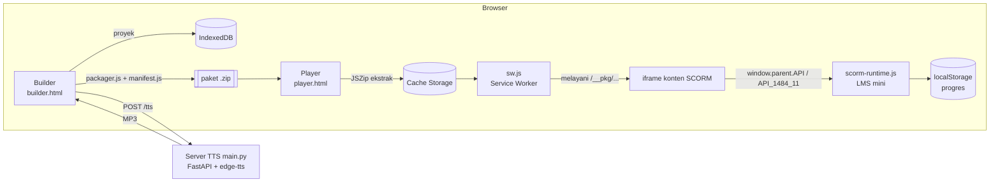

# Studio SCORM

Aplikasi web **open-source berbahasa Indonesia** untuk:

1. **SCORM Builder** — menyusun kursus e-learning (teks, gambar, kuis pilihan ganda) lalu mengekspornya menjadi paket `.zip` **SCORM 1.2** atau **SCORM 2004 4th Edition** yang siap diunggah ke Moodle atau LMS lain.
2. **SCORM Player** — mengunggah paket SCORM `.zip` buatan siapa pun, mengekstraknya **di browser**, lalu memutarnya lengkap dengan daftar isi, status, nilai, bookmark (resume), dan log komunikasi SCORM.
3. **Text-to-Speech gratis** — mengubah teks materi menjadi narasi MP3 bersuara natural (suara Neural Bahasa Indonesia **Gadis** & **Ardi**) melalui `edge-tts`, tanpa API key, mendukung teks panjang. Cadangan tanpa server: Web Speech API bawaan browser.

> Frontend tidak perlu proses *build* sama sekali — cukup HTML + JavaScript murni. Bisa langsung di-hosting gratis di **GitHub Pages**.

---

## Daftar isi

1. [Rekomendasi tech stack](#1-rekomendasi-tech-stack)
2. [Struktur repository (tanpa folder) & cara unggah](#2-struktur-repository-tanpa-folder)
3. [Menjalankan di komputer sendiri](#3-menjalankan-di-komputer-sendiri)
4. [Cara kerja SCORM Player (ekstrak & putar .zip)](#4-cara-kerja-scorm-player)
5. [Cara kerja SCORM Builder (membuat .zip + imsmanifest.xml)](#5-cara-kerja-scorm-builder)
6. [Text-to-Speech: pilihan, implementasi, dan batasannya](#6-text-to-speech)
7. [Deploy ke internet](#7-deploy-ke-internet)
8. [Menguji paket di LMS](#8-menguji-paket-di-lms)
9. [Keamanan & batasan yang perlu Anda tahu](#9-keamanan--batasan)
10. [Pengujian otomatis](#10-pengujian-otomatis)
11. [Ide pengembangan lanjutan](#11-ide-pengembangan-lanjutan)

---

## 1. Rekomendasi tech stack

| Bagian | Pilihan | Alasan |
|---|---|---|
| Frontend (Builder + Player) | **HTML + CSS + JavaScript murni (ES Modules)** | Tidak perlu `npm run build`, mudah dibaca developer menengah, langsung jalan di GitHub Pages. |
| Baca/tulis `.zip` | **[JSZip](https://stuk.github.io/jszip/)** (file `jszip.min.js` ikut di repo, tidak bergantung CDN) | Library paling matang untuk zip di browser. |
| Menyajikan isi zip ke iframe | **Service Worker + Cache Storage** | Satu-satunya cara agar link relatif di dalam paket (CSS, JS, gambar, audio) jalan normal — lihat bagian 4. |
| Penyimpanan proyek | **IndexedDB** (gambar & MP3 sebagai Blob) + `localStorage` (progres peserta) | Tanpa database server. |
| Server TTS | **Python + FastAPI + [edge-tts](https://github.com/rany2/edge-tts)** | Suara Neural gratis, tanpa API key, ±40 baris inti. |
| Hosting | **GitHub Pages** (frontend) + **Render / Hugging Face Spaces / VPS** (server TTS, via Docker) | Gratis untuk mulai. |

**Kapan pindah ke React/Next.js?** Bila nanti Anda butuh login multi-pengguna, database kursus di server, kolaborasi tim, atau laporan nilai terpusat. Logika inti (`manifest.js`, `scorm-runtime.js`, `packager.js`, `tts.js`) sudah ditulis sebagai modul murni sehingga bisa dipindahkan tanpa ditulis ulang.

### Arsitektur singkat



---

## 2. Struktur repository (tanpa folder)

Semua file sengaja diletakkan **langsung di root repository, tanpa subfolder**. Dengan begitu repo bisa diunggah lewat halaman web GitHub ("Add file → Upload files") sekaligus, tanpa risiko struktur folder rusak.

| File | Fungsi |
|---|---|
| `index.html` | Beranda aplikasi |
| `builder.html`, `builder.js` | Halaman & logika SCORM Builder |
| `player.html`, `player.js` | Halaman & logika SCORM Player |
| `sw.js` | Service worker Player — wajib sejajar dengan `player.html` |
| `app.css` | Tampilan aplikasi (mode terang & gelap) |
| `manifest.js` | Membuat & membaca `imsmanifest.xml` (1.2 dan 2004) |
| `packager.js` | Merakit paket `.zip` SCORM |
| `package-store.js` | Ekstrak `.zip` → Cache Storage, pustaka paket |
| `scorm-runtime.js` | API LMS: `window.API` (1.2) & `window.API_1484_11` (2004) |
| `tts.js` | Klien Edge TTS (server) + Web Speech API (browser) |
| `store.js`, `util.js` | IndexedDB sederhana & fungsi bantu |
| `jszip.min.js` | Library JSZip v3.10 (lisensi MIT/GPLv3) |
| `paket-index.html`, `course.js`, `course.css`, `scorm-api.js` | **Template** yang disalin ke dalam setiap paket SCORM. `paket-index.html` otomatis menjadi `index.html` di dalam .zip. |
| `contoh-apd.json` | Proyek contoh "Pengenalan APD" (tombol *Muat contoh* di Builder) |
| `pengenalan-alat-pelindung-diri-apd-scorm12.zip` / `...scorm2004.zip` | Paket contoh untuk mencoba Player |
| `main.py`, `requirements.txt`, `Dockerfile` | Server Text-to-Speech (FastAPI + edge-tts) |
| `test_main.py`, `*.test.mjs`, `build-sample.mjs`, `package.json` | Pengujian otomatis & pembuat paket contoh (tidak dipakai saat aplikasi berjalan) |

> **Jangan mengganti nama file.** Halaman saling memanggil berdasarkan nama. Khususnya jangan mengubah `paket-index.html` menjadi `index.html` — itu akan menimpa beranda aplikasi.

### Mengunggah ke GitHub lewat browser

1. Buat repository baru (Public).
2. Klik **uploading an existing file** (atau *Add file → Upload files*).
3. Ekstrak zip, buka foldernya, **pilih semua file (Ctrl+A)**, lalu seret ke halaman unggah GitHub — atau klik *choose your files* dan pilih semua. Keduanya aman karena tidak ada folder.
4. **Commit changes**.
5. **Settings → Pages → Build and deployment → Source: Deploy from a branch → `main` / `(root)` → Save.**
6. Tunggu 1–2 menit, buka `https://NAMA-ANDA.github.io/NAMA-REPO/` lalu tekan **Ctrl+F5**.


## 3. Menjalankan di komputer sendiri

**Prasyarat:** Node.js 18+ (untuk server lokal & tes) dan Python 3.10+ (untuk server TTS).

### Langkah 1 — Jalankan frontend

```bash
git clone https://github.com/NAMA-ANDA/studio-scorm.git
cd NAMA-REPO
npm run dev            # = npx serve -l 5173 .
```

Buka **http://localhost:5173**. Alternatif tanpa Node: `python -m http.server 5173`.

> ⚠️ Jangan membuka `player.html` dengan klik ganda (`file://`). Service worker hanya jalan di `http://localhost` atau `https://`.

### Langkah 2 — Jalankan server TTS

```bash
python -m venv .venv
# Windows: .venv\Scripts\activate    |   macOS/Linux: source .venv/bin/activate
pip install -r requirements.txt
uvicorn main:app --reload --port 8000
```

Cek **http://localhost:8000/docs** — FastAPI menyediakan halaman uji coba otomatis.

### Langkah 3 — Coba alurnya

1. Buka **Builder** → klik **Muat contoh** (kursus "Pengenalan APD").
2. Di panel kanan, isi alamat server TTS `http://localhost:8000` → **Cek** → pilih suara → **Buat suara untuk semua slide**.
3. Klik **Pratinjau** — paket dibuat dan langsung diputar di Player pada tab baru.
4. Klik **Unduh paket SCORM** → dapat file `.zip` siap unggah ke LMS.
5. Buka **Player** → unggah file `.zip` contoh (`pengenalan-alat-pelindung-diri-apd-scorm12.zip`) atau paket SCORM buatan tools lain (Articulate, iSpring, Adapt, dll.).

---

## 4. Cara kerja SCORM Player

### Masalah utama: link relatif

Paket SCORM adalah mini-website: `index.html` memuat `css/style.css`, `js/app.js`, `media/video.mp4`. Kalau isi zip diubah menjadi `blob:` URL, link relatif itu **putus** — tampilan kursus rusak. Solusinya: **service worker** yang berpura-pura menjadi web server.

```
Unggah .zip ─► JSZip ekstrak ─► setiap file disimpan di Cache Storage
                                         │
iframe membuka  ./__pkg/<id>/index.html  ▼
   └─ browser minta ./__pkg/<id>/css/style.css ─► sw.js menjawab dari cache ✔
```

### Kode inti — ekstrak .zip (ringkas dari `package-store.js`)

```js
const zip = await JSZip.loadAsync(file);                          // 1. baca zip di memori
const manifestEntry = Object.values(zip.files)
  .find((f) => /(^|\/)imsmanifest\.xml$/i.test(f.name));          // 2. cari manifest
const manifest = parseManifest(await manifestEntry.async('string'));

const cache = await caches.open('studio-scorm-paket-v1');
for (const entry of Object.values(zip.files)) {
  if (entry.dir) continue;
  const path = normalizeZipPath(entry.name);                      // 3. tolak "../" (zip-slip)
  const blob = await entry.async('blob');
  await cache.put(cacheKey(pkgId, path), new Response(blob, {
    headers: { 'Content-Type': mimeFor(path) },                   // 4. MIME benar → JS/CSS mau jalan
  }));
}
```

### Kode inti — service worker (ringkas dari `sw.js`)

```js
self.addEventListener('fetch', (event) => {
  const url = event.request.url.split('?')[0];
  if (!url.startsWith(PKG_PREFIX)) return;           // bukan file paket → biarkan lewat
  event.respondWith(servePackageFile(event.request, url.slice(PKG_PREFIX.length)));
});
// servePackageFile: ambil dari cache, fallback huruf besar/kecil (paket buatan Windows),
// dan dukung header Range (wajib untuk audio/video di Safari/iOS).
```

### Kode inti — API LMS (ringkas dari `scorm-runtime.js`)

Konten SCORM mencari objek API di `window.parent`. Player memasangnya sebelum memuat iframe:

```js
const runtime = new ScormRuntime({
  version: manifest.version,                         // '1.2' atau '2004'
  saved: loadProgress(sco.id),                       // untuk resume
  onCommit: (snap) => saveProgress(sco.id, snap),    // simpan ke localStorage
});
if (manifest.version === '2004') window.API_1484_11 = runtime.api;
else window.API = runtime.api;
iframe.src = packageUrl(pkg.id, sco.href);
```

`ScormRuntime` mengimplementasikan data model SCORM (status, skor, `suspend_data`, `interactions`, `objectives`, waktu), validasi tipe data, kode error resmi (1.2: 101–405, 2004: 101–408), akumulasi `total_time`, penentuan lulus otomatis dari `masteryscore` (1.2) / `scaled_passing_score` (2004), dan navigasi `adl.nav.request` (2004).

---

## 5. Cara kerja SCORM Builder

### Isi paket yang dihasilkan

```
pengenalan-apd-scorm12.zip
├─ imsmanifest.xml          ← "daftar isi" yang dibaca LMS
├─ index.html               ← halaman yang dibuka LMS
├─ assets/course-data.js    ← isi kursus Anda (judul, slide, soal)
├─ assets/course.js         ← mesin slide & kuis
├─ assets/scorm-api.js      ← lapor status & nilai ke LMS
├─ assets/course.css
└─ media/slide-02.png, media/narasi-01.mp3, ...
```

### Kode inti — merakit zip (ringkas dari `packager.js`)

```js
const zip = new JSZip();
zip.file('media/narasi-01.mp3', slide.audio.data);                        // Blob dari TTS
zip.file('assets/course-data.js', `window.COURSE_DATA = ${JSON.stringify(data)};`);
zip.file('index.html', template['index.html']);
zip.file('assets/course.js', template['course.js']);
// ...file template lain

const files = Object.keys(zip.files).filter((f) => !zip.files[f].dir);
zip.file('imsmanifest.xml', buildManifest({ version: '1.2', identifier, title, files, passingScore: 80 }));
const blob = await zip.generateAsync({ type: 'blob', compression: 'DEFLATE' });
```

> Isi kursus disimpan sebagai `course-data.js` (bukan `.json`) agar paket tetap bisa dibuka dengan klik ganda (`file://`) — `fetch()` file lokal diblokir browser, tapi `<script src>` tidak.

### Contoh `imsmanifest.xml` SCORM 1.2 yang dihasilkan

```xml
<?xml version="1.0" encoding="UTF-8"?>
<manifest identifier="pengenalan-apd-apd01" version="1.0"
  xmlns="http://www.imsproject.org/xsd/imscp_rootv1p1p2"
  xmlns:adlcp="http://www.adlnet.org/xsd/adlcp_rootv1p2" ...>
  <metadata>
    <schema>ADL SCORM</schema>
    <schemaversion>1.2</schemaversion>
  </metadata>
  <organizations default="ORG-pengenalan-apd-apd01">
    <organization identifier="ORG-pengenalan-apd-apd01">
      <title>Pengenalan Alat Pelindung Diri (APD)</title>
      <item identifier="ITEM-..." identifierref="RES-..." isvisible="true">
        <title>Pengenalan Alat Pelindung Diri (APD)</title>
        <adlcp:masteryscore>80</adlcp:masteryscore>
      </item>
    </organization>
  </organizations>
  <resources>
    <resource identifier="RES-..." type="webcontent" adlcp:scormtype="sco" href="index.html">
      <file href="index.html"/>
      <file href="assets/course.js"/>
      ...
    </resource>
  </resources>
</manifest>
```

Versi **2004 4th Edition** memakai namespace `imscp_v1p1` + `adlcp_v1p3`, atribut `adlcp:scormType` (huruf T besar), dan nilai lulus ditulis sebagai `imsss:minNormalizedMeasure` (0,80). Semua itu sudah ditangani `buildManifest()`.

### Apa yang dilaporkan kursus ke LMS

| Kejadian | SCORM 1.2 | SCORM 2004 |
|---|---|---|
| Kursus dibuka | `lesson_status = incomplete` | `completion_status = incomplete` |
| Pindah slide | `lesson_location`, `suspend_data` | `location`, `suspend_data`, `progress_measure` |
| Kuis dikirim | `interactions.n.*` (soal, jawaban, benar/salah) | `interactions.n.*` + `description` |
| Semua kuis selesai | `score.raw` + `lesson_status = passed/failed` | `score.scaled/raw` + `success_status` + `completion_status = completed` |
| Tanpa kuis | `completed` setelah semua slide dilihat | `completed` setelah semua slide dilihat |
| Jendela ditutup | `exit = suspend` (bisa dilanjutkan) + `session_time` | `exit = suspend` + `session_time` (format ISO-8601) |

Bila paket dibuka **tanpa LMS**, `scorm-api.js` berjalan dalam "mode mandiri" dan menyimpan progres di `localStorage`.

---

## 6. Text-to-Speech

### Perbandingan opsi gratis

| Opsi | Kualitas suara Indonesia | Teks panjang | Bisa jadi file MP3 di paket? | Catatan |
|---|---|---|---|---|
| **edge-tts** (dipakai di proyek ini) | ⭐⭐⭐⭐⭐ Neural (Gadis, Ardi) + suara *Multilingual* | ✔ (dipotong otomatis oleh server) | ✔ | Gratis, tanpa API key, **tidak resmi** — lihat batasan di bawah. |
| **Web Speech API** (cadangan) | ⭐⭐–⭐⭐⭐⭐ tergantung browser/OS peserta | ✔ (dipotong per kalimat) | ✘ hanya dibacakan langsung | 100% di browser, tanpa server. Di Microsoft Edge ada suara "Online (Natural)". |
| gTTS (Google Translate tidak resmi) | ⭐⭐⭐ | ✔ (dipotong ±100 karakter) | ✔ | Suara lebih robotik; rawan diblokir bila dipakai berat. Tidak dipakai. |
| Azure AI Speech (resmi) | ⭐⭐⭐⭐⭐ (suara sama dengan edge-tts) | ✔ | ✔ | Tier gratis F0: 0,5 juta karakter/bulan, perlu akun Azure & API key. Pilihan **produksi** yang paling mulus. |
| Piper (offline, open-source) | ⭐⭐⭐ | ✔ | ✔ | Jalan di server sendiri tanpa internet. Suara Indonesia `id_ID-news_tts-medium` masih berstatus draf di repositori resminya. |

### Kenapa voiceover dibuat sebagai MP3?

Karena suara yang ditanam di paket **sama persis** di LMS dan perangkat mana pun, tidak bergantung pada suara yang terpasang di laptop peserta. Web Speech API hanya dipakai sebagai cadangan (atau untuk "dengarkan cepat" saat menyunting).

### Bagaimana teks panjang ditangani (`main.py`)

```python
def split_text(text, limit=2500):
    # paragraf → kalimat → kata; potongan kecil digabung lagi agar intonasi mulus
    ...

chunks = split_text(text)
parts = [await synthesize_chunk(c, voice, rate, pitch, volume) for c in chunks]  # retry 3x per potongan
mp3 = b"".join(parts)    # MP3 edge-tts berformat sama → aman digabung langsung
```

Plus: **cache disk** (teks + suara sama tidak disintesis dua kali), **rate limit** per IP, **validasi** nama suara/rate/pitch, dan batas `MAX_CHARS` (default 20.000 karakter per permintaan — cukup untuk ±20 menit narasi per slide).

### API server TTS

```bash
# Daftar suara Indonesia (+ suara multibahasa)
curl http://localhost:8000/voices?lang=id

# Buat MP3
curl -X POST http://localhost:8000/tts \
  -H "Content-Type: application/json" \
  -d '{"text":"Selamat datang di pelatihan K3.","voice":"id-ID-ArdiNeural","rate":"-5%","pitch":"+0Hz"}' \
  -o narasi.mp3
```

### Kode klien di browser (`tts.js`)

```js
import { EdgeTTS, BrowserTTS } from './tts.js';

// 1) MP3 berkualitas tinggi via server
const mp3 = await new EdgeTTS('http://localhost:8000')
  .synthesize(teksPanjang, { voice: 'id-ID-GadisNeural', rate: -10, pitch: 0 });
audioElement.src = URL.createObjectURL(mp3);

// 2) Cadangan tanpa server: Web Speech API (dipecah per kalimat — menghindari bug Chrome
//    yang memotong ucapan panjang)
const voices = await BrowserTTS.voices('id');       // suara "Natural/Online" diurutkan paling atas
new BrowserTTS().speak(teksPanjang, { voice: voices[0], rate: 1 });
```

**Kamus pelafalan:** singkatan seperti `K3`, `APD`, `SOP` sering dibaca salah. Tambahkan istilah Anda di objek `PRONUNCIATION` dalam `tts.js`.

### Batasan TTS (penting dibaca)

- **edge-tts memakai layanan "Read Aloud" Microsoft Edge yang tidak resmi.** Gratis dan bagus, tetapi tanpa SLA dan secara teori bisa berubah atau dibatasi sewaktu-waktu. Untuk penggunaan komersial skala besar, baca ketentuan layanan Microsoft dan pertimbangkan pindah ke **Azure AI Speech** (cukup ganti isi fungsi `synthesize_chunk` di `main.py`; suaranya sama).
- Karena itu proyek ini menyimpan audio sebagai **file MP3 di dalam paket** — kalau layanan berubah, kursus yang sudah dibuat tetap bersuara.
- Jangan membuka server TTS untuk publik tanpa membatasi `ALLOWED_ORIGINS` dan `RATE_LIMIT_PER_MIN`.

---

## 7. Deploy ke internet

### A. Frontend → GitHub Pages (gratis)

1. Push repository ke GitHub.
2. **Settings → Pages → Build and deployment → Source: Deploy from a branch → `main` / `(root)`**.
3. Setiap kali file di repo diperbarui, GitHub Pages otomatis memperbarui situs (±1–2 menit).
4. Aplikasi tersedia di `https://NAMA-ANDA.github.io/NAMA-REPO/`.

### B. Server TTS (pilih salah satu)

**Render (Docker, ada paket gratis):** New → Web Service → hubungkan repo → Runtime **Docker** (Dockerfile ada di root repo). Tambahkan environment variable:

```
ALLOWED_ORIGINS=https://NAMA-ANDA.github.io
TRUST_PROXY=1
```

Paket gratis Render "tidur" bila tidak dipakai, sehingga permintaan pertama bisa lambat ±1 menit.

**Hugging Face Spaces (Docker):** buat Space tipe *Docker*, unggah `main.py`, `requirements.txt`, dan `Dockerfile`, lalu di bagian metadata (YAML) `README.md` Space tambahkan `app_port: 8000`. Atur `ALLOWED_ORIGINS` di *Settings → Variables*.

**VPS / server kantor:**

```bash
docker build -t studio-scorm-tts .
docker run -d -p 8000:8000 -e ALLOWED_ORIGINS=https://NAMA-ANDA.github.io --restart unless-stopped studio-scorm-tts
```

Pasang di belakang Nginx/Caddy dengan HTTPS.

> **HTTPS wajib.** Halaman GitHub Pages memakai `https://`, jadi server TTS juga harus `https://`; browser memblokir panggilan dari halaman HTTPS ke server `http://` biasa.

### Variabel lingkungan server TTS

| Variabel | Default | Fungsi |
|---|---|---|
| `ALLOWED_ORIGINS` | `*` | Domain frontend yang boleh memanggil (pisahkan dengan koma). |
| `MAX_CHARS` | `20000` | Batas panjang teks per permintaan. |
| `CHUNK_CHARS` | `2500` | Ukuran potongan teks ke edge-tts. |
| `RATE_LIMIT_PER_MIN` | `30` | Batas permintaan per IP per menit. |
| `CACHE_DIR` / `CACHE_MAX_MB` | `./cache` / `500` | Lokasi & ukuran maksimal cache MP3. |
| `DEFAULT_VOICE` | `id-ID-GadisNeural` | Suara bawaan. |
| `TRUST_PROXY` | `0` | Set `1` bila di belakang proxy (Render/HF/Nginx) agar rate limit membaca IP asli. |

---

## 8. Menguji paket di LMS

1. **Uji cepat** di Player aplikasi ini: buka panel *Log komunikasi SCORM* — setiap `SetValue` yang gagal tampil merah lengkap dengan kode error.
2. **Moodle:** *Add an activity → SCORM package* → unggah `.zip` → simpan → buka sebagai peserta → cek *Reports*: status, nilai, dan jawaban per soal (interactions) harus tercatat.
3. **Layanan uji SCORM** seperti SCORM Cloud (Rustici) berguna untuk memastikan kompatibilitas sebelum dipakai di LMS produksi.

Tips: pilih **SCORM 1.2** bila ragu — paling luas dukungannya. Pilih **2004** bila LMS Anda membutuhkan status *completion* dan *success* terpisah, atau `suspend_data` lebih dari 4.096 karakter.

---

## 9. Keamanan & batasan

- **Konten paket berjalan di origin yang sama dengan aplikasi** (wajib, agar konten bisa menemukan `window.API`). Artinya JavaScript di dalam paket bisa membaca penyimpanan browser aplikasi ini. Putar hanya paket dari sumber tepercaya. Untuk layanan publik multi-pengguna, hosting Player di subdomain terpisah dari Builder.
- **Zip bomb & zip-slip** dicegah: batas 10.000 file / 1 GB hasil ekstrak, dan path `../` ditolak.
- **Penyimpanan lokal:** proyek dan progres ada di browser yang dipakai. Gunakan **Ekspor proyek** untuk cadangan. Browser bisa menghapus data situs bila ruang penyimpanan penuh.
- **SCORM 2004 sequencing** (aturan prasyarat, rollup kompleks) tidak diimplementasikan penuh; Player menjalankan navigasi berurutan, pilihan dari daftar isi, dan `adl.nav.request` dasar (continue/previous/choice). Cukup untuk hampir semua paket satu-SCO maupun multi-SCO sederhana.
- File skema `.xsd` tidak disertakan dalam paket; mayoritas LMS tidak memerlukannya. Bila LMS Anda meminta, salin file XSD resmi ADL ke root paket.

---

## 10. Pengujian otomatis

```bash
npm install
npm test                       # 17 tes: manifest 1.2/2004, runtime API, packager
npm run build:sample           # membuat ulang 2 paket contoh .zip

pip install -r requirements.txt pytest httpx
pytest -q                      # 6 tes server TTS (edge-tts ditiru, tanpa internet)
```

Semua tes dijalankan dari root repo.

---

## 11. Ide pengembangan lanjutan

- **Subtitle otomatis:** edge-tts mengirim *WordBoundary* — bisa diubah menjadi file `.vtt` untuk teks berjalan.
- **Tipe slide baru:** video, benar/salah, mencocokkan, urutan langkah (SCORM interaction `matching`, `sequencing`).
- **Multi-SCO:** satu bab = satu SCO agar LMS mencatat progres per bab.
- **Ekspor xAPI / cmi5** untuk LRS modern.
- **Login & database** (mis. Supabase) bila ingin kursus tersimpan di cloud dan dikerjakan bersama tim.

---

## Lisensi

[MIT](LICENSE). JSZip © Stuart Knightley, dilisensikan MIT/GPLv3 (lihat `jszip.min.js`).
